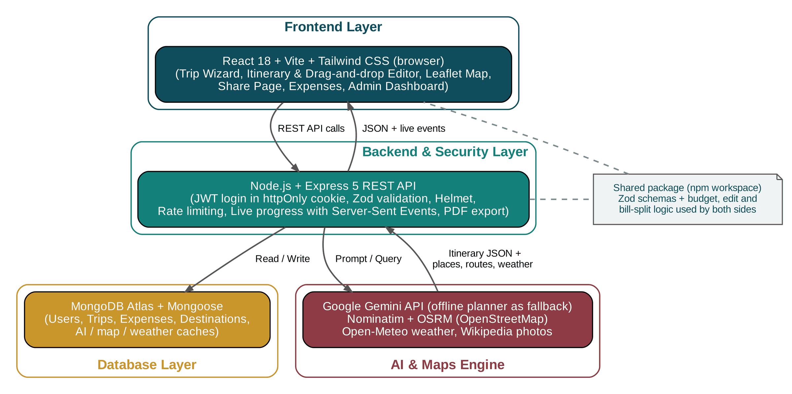
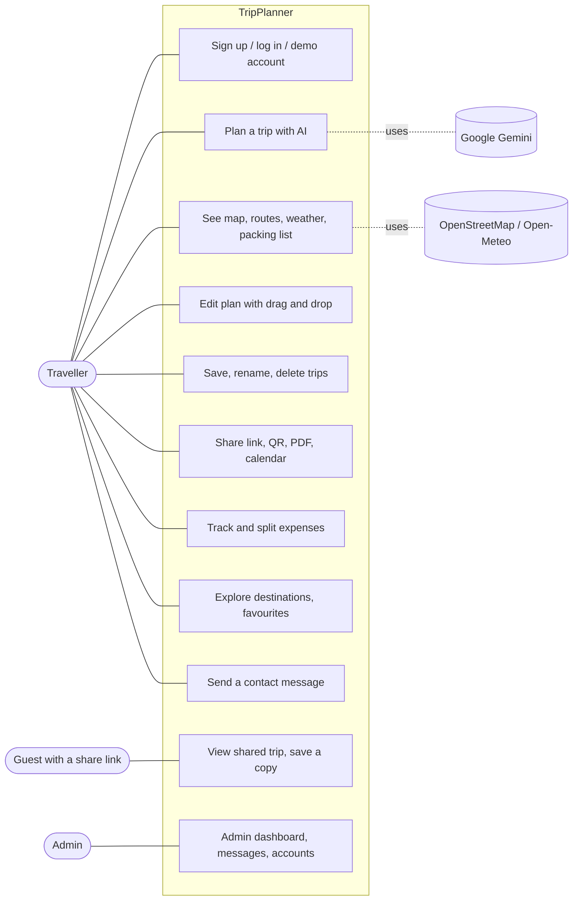
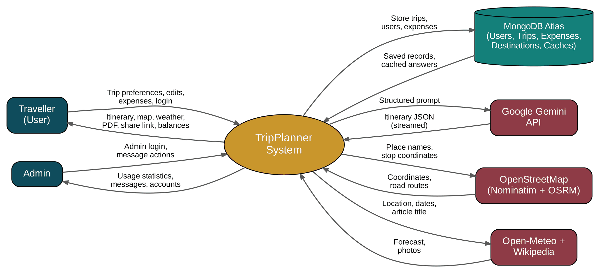
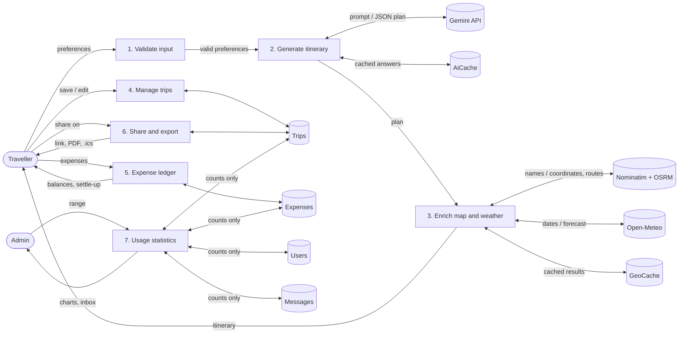
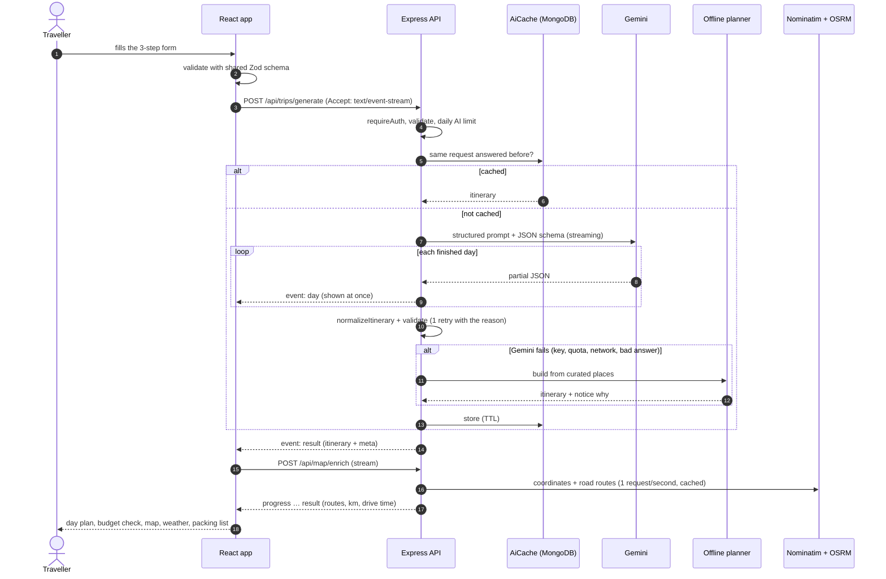
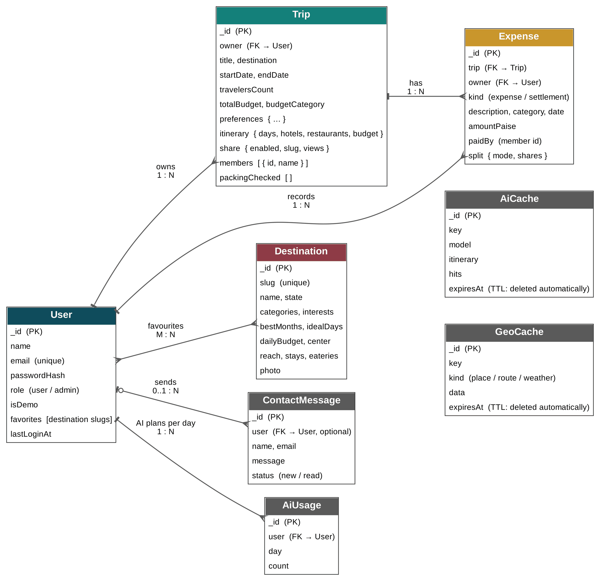
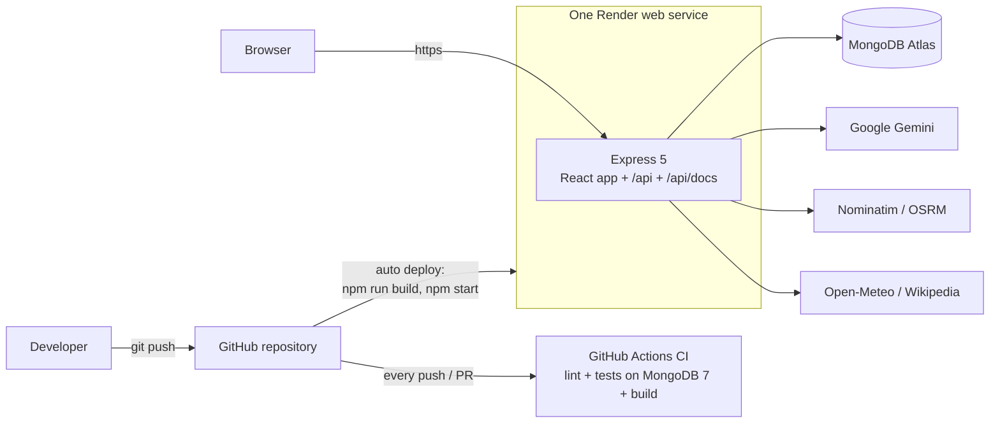

# TripPlanner — Architecture

This document describes how TripPlanner is built: the layers, the data, the main flows and the key algorithms.
The pictures in [`docs/diagrams/`](diagrams/) are ready for the project report (PNG + Graphviz `.dot` sources);
the Mermaid diagrams below render directly on GitHub (or paste them into <https://mermaid.live> to export a PNG).

---

## 1. Layers



| Layer | Technology | Responsibility |
| --- | --- | --- |
| Frontend | React 18, Vite, Tailwind CSS, React Router, Leaflet, @dnd-kit | Trip wizard, itinerary, map, drag-and-drop editor, sharing, expenses, admin dashboard |
| Backend & security | Node.js 22, Express 5, JWT (httpOnly cookie), bcrypt, Helmet, express-rate-limit, PDFKit | REST API, live progress (Server-Sent Events), validation, login, PDF export, serves the built app in production |
| Database | MongoDB Atlas + Mongoose | Users, trips (with itinerary), expenses, destinations, contact messages, caches |
| AI & maps engine | Google Gemini (`@google/genai`), Nominatim, OSRM, Open-Meteo, Wikipedia API | Itinerary generation; coordinates, road routes, weather, destination photos |
| Shared package | Zod 4 + plain JavaScript (`shared/`) | One copy of the data contracts and business rules, used by client **and** server |

"Contract first": the same Zod schema checks a form in the browser, the request on the server, the document before it is
saved and the answer of the AI. Budget maths, plan editing, calendar files and the expense ledger are also in `shared/`,
so the screen and the server can never disagree.

### Folder structure

```
tripplanner/
├── shared/src/        schemas/ (Zod), itinerary/ (normalize, edit), expenses/ (ledger in paise), utils/ (dates, budget,
│                      map, weather codes, packing list, calendar .ics), constants.js, projectInfo.js
├── server/src/
│   ├── app.js         middleware order, routes, API docs, React app in production
│   ├── server.js      connect DB → seed demo data + destinations → listen; clean shutdown
│   ├── config/        env.js (validated settings), db.js
│   ├── middleware/    auth (JWT), validate / validateQuery (Zod), rateLimiter, errorHandler
│   ├── routes/ → controllers/ → services/ → models/
│   ├── services/ai/   Gemini client + streaming, prompt, cache + daily limit, offline planner
│   ├── services/geo/  Nominatim geocoder, OSRM router, one polite queue per service, MongoDB cache
│   ├── docs/          OpenAPI description (from the shared schemas) + /api/docs page
│   └── web/           serves client/dist, link previews for /share/:slug
└── client/src/        pages/, components/ (itinerary, editor, map, expenses, admin, share), services/api.js
```

### Request lifecycle

`helmet` (security headers, CSP) → `cors` (allow-list) → `express.json` (1 MB, JSON only) → `cookie-parser` →
rate limit (`/api`) → route → `requireAuth` / `requireRole('admin')` → `validateBody` / `validateQuery` (shared Zod) →
controller → service (every trip query includes the owner's id) → Mongoose model.
Any error ends in `errorHandler` → `{ success: false, error, details? }` with the right status code (no stack traces in production).

---

## 2. Use cases



---

## 3. Data flow

### Level 0 (context)



### Level 1



---

## 4. Main flow: generating a trip (live)



---

## 5. Database



| Collection | Purpose | Notes |
| --- | --- | --- |
| `users` | accounts | unique e-mail, bcrypt hash, role `user` / `admin`, favourite destination slugs |
| `trips` | saved trips | one document per trip with the whole itinerary; `owner` index; unique sparse `share.slug`; `schemaVersion` |
| `expenses` | trip expenses and payments | amounts in **integer paise**; `kind` expense / settlement; index on trip + owner + date |
| `destinations` | 26 Indian destinations | seeded on server start; Wikipedia photo cached 30 days |
| `contactmessages` | contact form | status new / read (admin inbox) |
| `aiusages` | AI plans per user per day | unique (user, day) — daily limit |
| `aicaches` | AI answers | TTL index: MongoDB deletes them after `AI_CACHE_DAYS` |
| `geocaches` | places, routes, weather | TTL index; forecasts expire after a few hours |

Why documents: a plan is read and written as a whole (days → activities, stays, restaurants, budget), so one trip
document needs one read. Expenses grow during the trip, so they live in their own collection linked to the trip.

---

## 6. Key algorithms

| Algorithm | Where | Idea |
| --- | --- | --- |
| Itinerary normalization | `shared/src/itinerary/normalize.js` | Any plan (AI, offline, old saved) is cleaned to one shape; the budget breakdown is recomputed so the parts always add up to the total. |
| Streaming day extraction | `server/src/services/ai/dayStream.js` | Gemini streams JSON text; a small scanner finds each complete `day` object in the partial text and sends it to the browser at once (Server-Sent Events). |
| Minimal-disruption re-timing | `shared/src/itinerary/edit.js` | A dragged activity takes the slot where it is dropped; later activities move only if they would overlap, so the rest of the day keeps its times. |
| Polite geocoding | `server/src/services/geo/geoHttp.js`, `geocoder.js`, `router.js` | One queue per service (≥ 1.1 s apart), identifying User-Agent, results cached in MongoDB; matches more than 300 km from the destination are rejected; road route simplified to ≤ 400 points; if routing fails, straight-line × 1.35 is shown as an estimate. |
| Bill split in paise | `shared/src/expenses/money.js` | All money is integer paise; an even split hands out the remainder one paisa at a time, so totals always match exactly. |
| Settle-up | `shared/src/expenses/ledger.js` | Greedy: the person who owes most pays the person owed most, repeat → at most *n − 1* payments. |
| Packing list | `shared/src/utils/packing.js` | Rules on weather, planned activities, terrain, food preference and group size; every item carries its reason. |
| Calendar file | `shared/src/utils/calendar.js` | RFC 5545 `.ics`: one all-day event per day + one event per timed activity (IST → UTC), stable UIDs. |

---

## 7. Security and privacy

- Passwords: bcrypt (10 rounds). Session: JWT (HS256) in an **httpOnly**, `SameSite=Lax` cookie (`Secure` in production).
- Same message for a wrong e-mail and a wrong password; login, AI, map, export and contact routes are rate-limited.
- JSON bodies only (a plain HTML form on another site cannot post JSON) — part of the CSRF protection.
- Every input validated with the shared Zod schemas; every trip / expense query includes the owner's id.
- Helmet headers with a Content Security Policy (scripts only from the site itself), `Referrer-Policy: strict-origin-when-cross-origin`
  (OpenStreetMap tiles need a Referer), no `X-Powered-By`, no stack traces in production.
- Share links: 64 random bits (11 characters); the public page never shows e-mail, home city, notes, packing ticks or expenses.
- Admin dashboard: counts and totals only.

---

## 8. Deployment



One service serves the app **and** the API from the same address, so the login cookie is first-party in every browser
(Safari blocks third-party cookies), live progress needs no extra proxy, and `/share/:slug` pages get link previews.
Step by step: [DEPLOY.md](DEPLOY.md). A `Dockerfile` is included for any Docker host.
